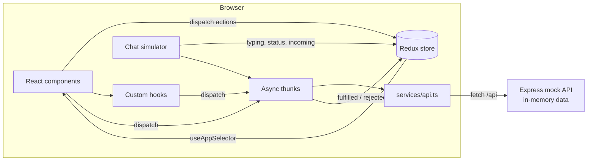

# Architecture

This document explains how the app is put together and why. The goal was to keep it simple and easy to follow, and still cover what the assignment asks for: feature based folders, reusable components, business logic outside of the UI, and one central place for state.

## Diagram



The flow always goes in one direction. Components read from the store and dispatch actions. Anything that talks to the server is an async thunk, and only `services/api.ts` calls `fetch`. Components never call the API directly.

## Folders

| Folder | What goes there |
| --- | --- |
| `app/` | Store setup, typed `useAppDispatch` / `useAppSelector`, the small `ui` slice (theme, group panel), `App` and the main layout |
| `features/users` | Users slice: the current user and all users by id |
| `features/conversations` | Sidebar components, conversations slice, selectors and helper functions like `getConversationName` |
| `features/chat` | Chat window components, messages slice, thunks for sending and the simulator |
| `features/groups` | Group info panel |
| `features/theme` | Theme toggle and the hook that adds the `dark` class to `<html>` |
| `services/` | All API calls in one object (`chatApi`) |
| `shared/` | Components and hooks used in more than one feature: `Avatar`, `EmptyState`, `ErrorState`, `Spinner`, `useDebounce`, `useClickOutside`, date helpers |
| `types/` | `User`, `Conversation`, `Message` and the other models |

Each feature owns its slice and its components. Shared code only goes in `shared/` once more than one feature needs it.

## State management

I used Redux Toolkit. The app has a few pieces of state that many components need at the same time (the selected chat, unread counts, typing users, the reply being written), and Redux keeps all of that in one place with good dev tools. Redux Toolkit also removes most of the boilerplate.

The store has four slices:

```ts
{
  users: {
    me: User | null,
    byId: Record<string, User>,
    loading, error
  },
  conversations: {
    list: Conversation[],
    selectedId: string | null,
    search: string,
    filter: 'all' | 'unread' | 'groups',
    typing: Record<conversationId, userId[]>,
    loading, error
  },
  messages: {
    byConversation: Record<conversationId, {
      items: Message[],
      hasMore, loaded, loading, loadingOlder, error
    }>,
    replyTo: Message | null,
    editing: Message | null
  },
  ui: {
    theme: 'light' | 'dark',
    isGroupInfoOpen: boolean
  }
}
```

A few decisions:

- **Messages are stored per conversation.** Switching back to a chat you already opened does not fetch it again (`fetchMessages` has a `condition` that skips the request when the chat is already loaded).
- **The conversations slice listens to message actions.** When a message is sent or received, the conversations slice updates the last message, moves the chat to the top and increases the unread count if the chat is not open. Components only dispatch one action and both slices stay in sync.
- **Filtering the sidebar is done in a memoized selector** (`selectFilteredConversations` with `createSelector`), so the list is only recalculated when the list, search, filter or users change.
- **Local UI state stays in components.** Things like "is the message menu open", "is the user scrolled to the bottom" or the chat search text are `useState`, because nothing else needs them.

## Sending a message

Sending is optimistic so the chat feels fast:

1. `MessageInput` dispatches `sendChatMessage`.
2. `sendMessage.pending` adds a temporary message with status `sending`. Its id is the thunk's `requestId`.
3. The API call is made. The request includes the `requestId` as `clientId`.
4. On success, `sendMessage.fulfilled` replaces the temporary message with the saved one (matched by `clientId`).
5. On failure, the message is marked as `failed` and shows a retry button.
6. After a successful send, `simulateMessageStatus` changes the status to `delivered` and then `read`, and sometimes triggers a reply from the other person.

## Simulating real-time behaviour

Everything "real-time" is in `features/chat/chatThunks.ts`:

- `simulateReply` sets a typing indicator, waits a moment, then creates a message from another user through the API.
- `simulateMessageStatus` moves your message from sent to delivered to read.
- `simulateRandomActivity` runs every 20 seconds (from the `useChatSimulator` hook). It picks a random chat, makes someone type and reply, and sometimes changes someone's online status.

Keeping this in thunks means the components do not know whether messages come from a simulator or a real socket. Replacing it with WebSockets later would only change this file.

## Components

The chat window is split into small components:

```
ChatWindow
├── ChatHeader          name, status or typing text, search and info buttons
├── MessageList         loading / error / empty states, date dividers, scrolling
│   ├── DateDivider
│   ├── MessageBubble   text, reply quote, status ticks, reactions
│   │   └── MessageMenu reactions, reply, copy, edit, delete
│   └── TypingIndicator
├── MessageInput        React Hook Form, Enter to send, reply and edit banner
└── GroupInfoPanel      members, add and remove
```

`ChatWindow` gets `key={conversation.id}` in the layout. When you switch chats, React creates a fresh chat window, so scroll position, search text and open menus reset without any extra code.

`MessageBubble` and `ConversationItem` are wrapped in `React.memo`, and the callback passed to `ConversationItem` comes from `useCallback`, so a new message does not re-render every bubble or every chat in the sidebar.

## Custom hooks

| Hook | Purpose |
| --- | --- |
| `useInitialData` | Loads users and conversations when the app starts |
| `useOpenConversation` | Selects a chat, loads its messages and marks it as read |
| `useChatSimulator` | Starts the activity timer and clears it on unmount |
| `useApplyTheme` | Adds or removes the `dark` class and saves the theme |
| `useDebounce` | Delays the sidebar search by 300ms |
| `useClickOutside` | Closes the message menu on outside click or Esc, and removes the listeners afterwards |

## Styling and theme

Tailwind v4 with the palette from the brief:

| Name | Hex | Used for |
| --- | --- | --- |
| cream | `#F2EDD5` | App background (light), text on dark surfaces |
| brand | `#E7390D` | Send and add buttons, errors, delete |
| accent | `#F26716` | Unread badges, typing text, read ticks, sender names |
| forest | `#084A24` | Your message bubbles, active filter |
| deep | `#04261E` | Headers, app background (dark) |

Colors that change between light and dark mode (background, panels, text, borders, bubbles) are CSS variables in `index.css`. Tailwind classes like `bg-panel` or `text-muted` point to these variables, so components do not need `dark:` classes everywhere. Switching the theme only toggles the `dark` class on `<html>`.

## Mock server

`server/src/index.js` is a plain Express app with an in-memory store:

| Method | Route | Description |
| --- | --- | --- |
| GET | `/api/me` | Current user |
| GET | `/api/users` | All users |
| GET | `/api/conversations` | Conversations with their last message |
| POST | `/api/conversations/:id/read` | Mark as read |
| GET | `/api/conversations/:id/messages?before=&limit=` | Messages, newest page first |
| POST | `/api/conversations/:id/messages` | Send a message |
| PATCH | `/api/messages/:id` | Edit your message |
| DELETE | `/api/messages/:id` | Delete your message (soft delete) |
| POST | `/api/messages/:id/reactions` | Toggle a reaction |
| POST | `/api/conversations/:id/members` | Add a member to a group |
| DELETE | `/api/conversations/:id/members/:userId` | Remove a member |

Every request has a random delay of 150 to 500ms so loading states are visible. The data is generated with a seeded random function, so it is the same every time the server starts.

Messages use cursor pagination (`before=<messageId>`) instead of page numbers. New messages arriving at the end do not shift the pages when loading older ones.
